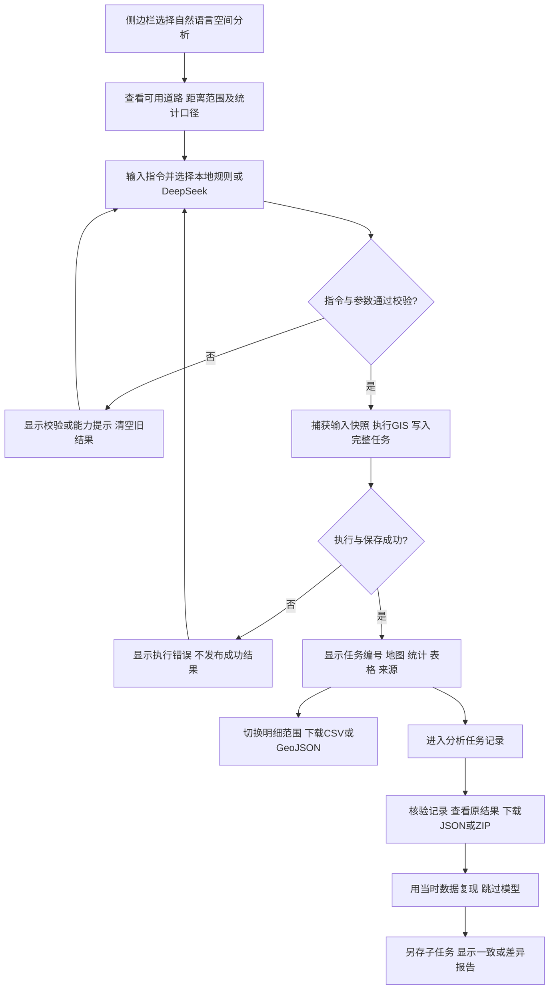

# 用户流程与状态

| 状态 | 页面行为 | 数据行为 |
|---|---|---|
| 初始 | 显示示例、范围、输入框 | 读取当前输入用于道路列表 |
| 提交中 | 显示处理提示 | 新请求先清空会话中的旧结果 |
| 解析拒绝 | 说明输入或能力边界 | 不保存任务 |
| 执行失败 | 显示公共错误提示，详情记录终端 | 不发布不完整任务 |
| 成功 | 结果带任务编号 | 快照和结果保存到独立目录 |
| 筛选/下载/界面重跑 | 明细范围变化，汇总不变 | 不重复保存成功任务 |
| 历史复现 | 显示原任务与复现对比 | 新增带 parent_task_id 的任务，不覆盖原任务 |

知识问答是独立入口：输入问题 → 检索至多3个片段 → DeepSeek回答 → 展示参考片段；不会自动进入空间计算。道路500米页面可查看既有真实结果或模拟结果，其按钮在真实数据模式执行重新核验；可变距离、CSV与历史闭环以自然语言入口为主。
