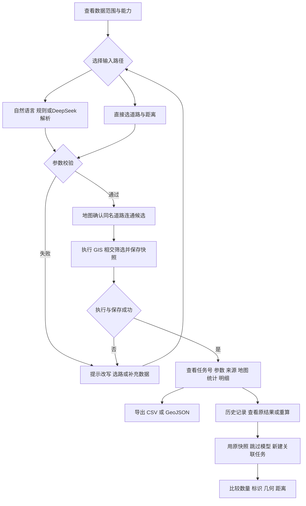

# 当前用户流程与状态（2026-11-12）

适用海淀区及周边本地数据主线；旧昌盛路验收模式另行保留。

初始或无数据时引导准备数据；解析等待、拒绝、计算失败与保存失败不当作成功。改道路/距离后需再次执行，已保存结果按原任务参数理解。筛选表格、下载及界面重跑不应重复创建成功任务。历史重算不读当前数据包，不覆盖原任务。

统计总数是附近包围框读取样本，不是行政区总体；相交包括部分相交与边界接触。知识问答为独立流程：问题 → Top3 检索 → DeepSeek 回答 → 查看来源，不自动执行空间计算。

公网预览仅有合成交互、本地知识检索及历史记录；真实模型请求与本地运行以明确标记的回放呈现，不称实时服务。
