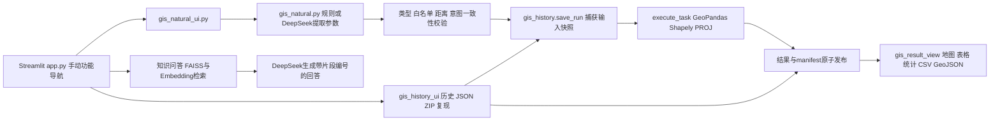

# 实现与数据架构

## 当前架构补充（2026-11-12）

当前主应用自然语言页面默认进入 `gis_local_ui.py`：直接选道路/距离或经 `gis_local_parser.py` 调用规则/DeepSeek → 校验 → `gis_local.py` 根据本地 GeoPackage 名称索引产生连通候选 → 用户确认 → 空间索引读附近建筑 → `gis_history.save_run` 与原 GIS 引擎计算 → 结果/导出/历史复现。模型不接收建筑几何，不负责计数。知识问答仍为独立 BGE/FAISS/DeepSeek 路径。

`gis_natural_ui.py` 对应旧昌盛路验收模式；`online_app.py` 为超时未通过真实在线验收的独立实验入口。公开 `docs/demo-v2/` 为合成交互与保存结果回放，不连接生产 API。

以下 2026-10-18 架构保留为旧模式说明，不能据此认为当前只支持昌盛路。当前需求见 [PRD](../05_Demo/Portfolio/GeoAI-Assistant_PRD_v2.0_AI产品版.md)。

基于2026-10-18当前源码核对。保留现有计算与解析逻辑，不引入通用 Agent 框架。



## 模块职责

| 模块 | 实际职责 |
|---|---|
| app.py | 加载根目录.env，功能选择；定义问答检索与回答流程 |
| gis_natural.py | 不支持意图拦截、规则/模型 JSON 提取、BufferTask 校验、数据读取与可变半径空间计算 |
| gis_natural_ui.py | 参数说明、缓存输入、提交、错误分类、保存结果展示与来源说明 |
| gis_history.py | 输入字节快照、结果与代码快照、环境版本、SHA-256、临时目录发布、重载、导出与快照重算 |
| gis_history_ui.py | 历史记录列表、选择原任务、下载与复现比对 |
| gis_result_view.py | 共享自然语言/历史结果视图、CSV 与 GeoJSON |
| gis_feature.py / gis_real_results.py | 原500米分析页面、模拟数据路径、真实保存结果核验、共享地图 |
| ingest.py | Markdown按400字符分块、重叠80；embedding归一化；FAISS IndexFlatIP建库 |
| evaluate_project.py / evaluation_report.py | 冻结用例、独立参考、隔离任务导出/复现、报告与失败保留 |

没有运行时 LangChain Agent、任意代码执行或模型动态工具调度。模型调用名为 `deepseek-chat`，不根据产品名称推断具体服务端版本。

## 数据布局与生命周期

```text
03_Data/
  raw_documents/osm_test/target_road.geojson, buildings_osm.geojson  当前输入
  gis_target_road_results/                                      原500米保存结果
  gis_samples/                                                 人工模拟示例
  knowledge_base/*.md                                          本地知识资料
  vector_database/gis.index, metadata.json                      问答索引
  evaluation/                                                  冻结评测用例
  analysis_tasks/<任务编号>/
    manifest.json                                              指令 参数 统计 来源 校验 环境
    inputs/*.geojson                                           原始字节快照
    results/roads, buildings, buffer, selected_buildings.geojson
    engine/*.py                                                4份计算相关源码快照
```

一次任务读取两份输入字节，核对界面读取时的指纹；在临时目录基于快照执行；全部结果和清单写好才重命名发布。正式数据和既有500米结果不被自然语言分析覆盖。评测任务保存在报告 evidence 中，与正式记录分开。

历史查看依赖保存文件，无需当前输入；复现用旧输入、旧参数和当前程序，不请求模型、不运行归档代码。比较几何容差为1e-9度，距离绝对容差0.011米，并核对关键字段；不是逐字节文件一致或所有属性完全一致。环境/引擎变化会提示。SHA-256可以发现文件与清单不一致，清单本身没有签名，因此不宣称不可篡改。

## 坐标系与统计

输入经 read_layer 统一到 EPSG:4326，并检查适用范围；当前源文件也是 EPSG:4326。计算投影固定 EPSG:32650。按同名道路 union → buffer(d) → 建筑 intersects → 距离与筛选标记 → 输出4326。限制与数据证据见 ../01_Product/DataSources.md。

## 外部依赖和安全

规则、计算、历史复现无需在线大模型。问答/DeepSeek解析向供应商发送问题或指令（解析还包含可用道路名），问答包含检索片段；不上传几何作为模型计算输入。在线底图和前端资源可能需要网络，不能把核心计算离线等同于全新机器浏览器完全离线可用。

根目录.env保留在本机，不进入代码快照或任务ZIP。ZIP仍含输入几何、指令和本机来源路径，分享前审核。项目无账号权限、多租户隔离或生产安全加固，应作为本地个人演示运行。
